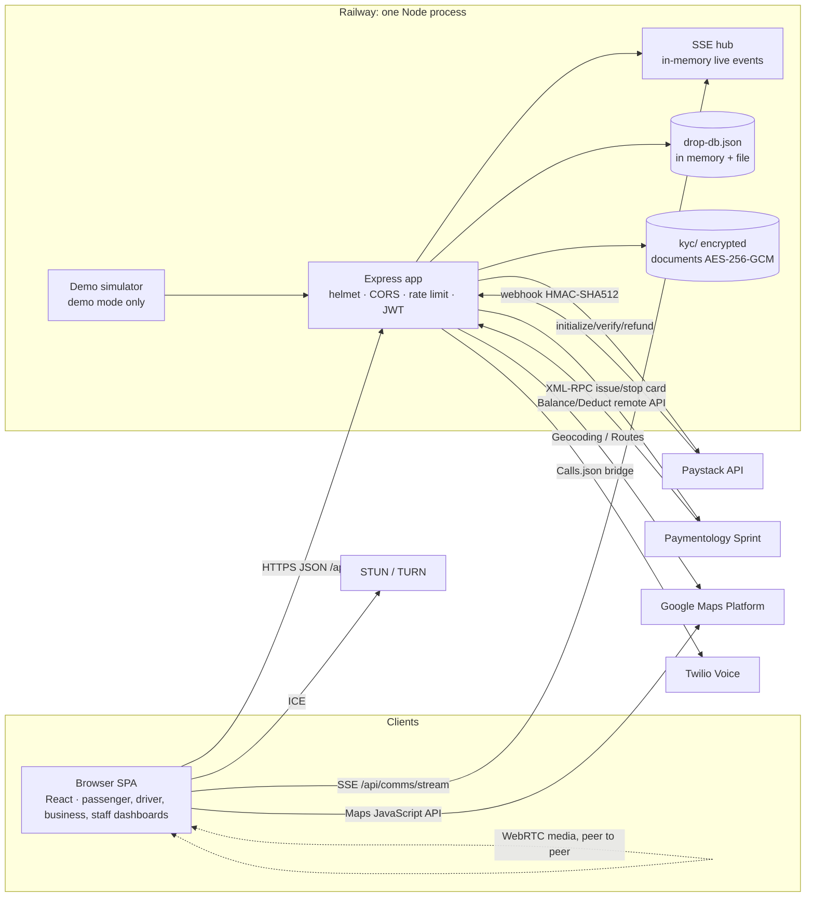

# 01 · System inventory: DROP (Drivers Owned Platform)

Phase 1 of the security, mobile and scalability programme. This is a map of what exists today. **Nothing has been changed yet.**
Repository: `ashlygoosen-lang/Drivers-Owned-Platform-` · commit `45904fb` · inventory date 25 Nov 2026.

## 0. Answers to the brief's placeholders (as found in the code)

| Placeholder | Actual |
|---|---|
| Website | React 19 + Vite 8 + Tailwind v4 + TypeScript, a single-page app (`frontend/`) |
| Backend / API | Node.js 22 + Express 4 (ES modules) (`backend/`) |
| Database | **No database server.** A single JSON file (`DATA_DIR/drop-db.json`), loaded fully into memory and rewritten atomically on every change. Uploaded documents are encrypted files in `DATA_DIR/kyc/`. |
| Hosting | Railway, single service: Express serves the API and the built frontend (`railway.json`). |
| Mobile app | **Not started.** A roadmap only (`docs/APPS-ROADMAP.md`). The website is mobile-responsive. |
| Payments | Paystack (passenger card payments, refunds, webhook); Paymentology Sprint (driver cards: card issuing plus remote authorisation API) |
| Other providers | Google Maps Platform (Maps JS, Geocoding, Routes); Twilio Voice (masked calls, optional); STUN/TURN for WebRTC calls |

## 1. Architecture

There is no cache, queue, worker, search engine, CDN or separate admin app. Every staff role uses the same SPA, behind role checks on the server.

## 2. API endpoints (97)

Legend: **Auth**: — = public, opt = optional, ✓ = signed in. Every booking, call and document id is a random UUID; booking **refs** (`DRP-1001`…) are sequential and are also accepted where noted.

### Auth and account (`routes/auth.js`)
| Method & path | Auth | Role | Input | Reads / writes |
|---|---|---|---|---|
| POST /api/auth/register | — | — | name, email, phone, password, role (passenger/business), company | users (creates) · returns JWT |
| POST /api/auth/login | — | — | email, password | users · returns JWT (7 days) |
| GET /api/auth/me | ✓ | any | — | users |
| PATCH /api/auth/me | ✓ | any | name, phone, savedPlaces, paymentPreference, notifications, currentPassword/newPassword | users |
| GET /api/auth/demo | — | — | — | demo account list (empty when demo is off) |
| POST /api/auth/demo | — | — | role | issues a JWT for a demo account (**demo mode only**) |

### Bookings and fares (`routes/bookings.js`)
| Method & path | Auth | Role | Input | Reads / writes |
|---|---|---|---|---|
| GET /api/places, /api/services | — | — | — | static |
| POST /api/fares/estimate | opt | — | service, pickup, destination, category | computed |
| POST /api/bookings | ✓ | passenger, business (verification gate) | service, category, pickup, destination, passengers, parcel, passengerName, notes, payment, scheduledFor | bookings (creates; **fare computed on the server**) |
| GET /api/bookings | ✓ | own | — | bookings |
| GET /api/bookings/:id (id or ref) | ✓ | owner, assigned driver, admin; drivers can see `requested` | — | bookings, users (driver/passenger contact) |
| POST /api/bookings/:id/cancel | ✓ | owner/admin; driver releases | reason | bookings, ledger (refund) |
| POST /api/bookings/:id/rate | ✓ | passenger owner | rating, feedback | bookings, users.rating |

### Drivers (`routes/drivers.js`, `routes/tracking.js`)
| Method & path | Auth | Role | Input | Reads / writes |
|---|---|---|---|---|
| POST /api/drivers/apply | opt | — / passenger | name, email, phone, password, vehicle, year, colour, seats, participation, city, consent | users, applications, verifications |
| GET /api/drivers/application | ✓ | driver | — | applications |
| POST /api/drivers/online | ✓ | driver (verified + approved) | online | users |
| GET /api/drivers/requests | ✓ | driver | — | bookings (open requests + active trip) |
| POST /api/drivers/bookings/:id/accept | ✓ | driver | — | bookings (assign), wallet debt check |
| POST /api/drivers/bookings/:id/advance | ✓ | assigned driver | — | bookings, ledger (settlement on completion) |
| POST /api/drivers/location | ✓ | driver (approved, online/on trip) | lat, lng, heading, speed, accuracy | users.location, bookings.trail, SSE |

### Live tracking and communication (`routes/tracking.js`, `routes/comms.js`)
| Method & path | Auth | Role | Input | Reads / writes |
|---|---|---|---|---|
| GET /api/maps/config | — | — | — | returns the **browser** Maps key (public by design) |
| GET /api/bookings/:id/tracking (id or ref) | ✓ | trip parties, admin/support | — | users.location, bookings, Google Routes |
| POST /api/bookings/:id/my-location | ✓ | passenger owner | lat, lng, accuracy / stop | memory only, SSE |
| GET /api/admin/fleet | ✓ | admin, support | — | users.location, bookings |
| GET /api/comms/config | ✓ | any | — | ICE servers (TURN credentials) |
| POST /api/comms/ticket | ✓ | any | — | one-use 60 s stream ticket (memory) |
| GET /api/comms/stream?ticket= | ticket | any | ticket (query) | SSE stream |
| GET /api/comms/threads | ✓ | any | — | bookings, messages |
| GET /api/bookings/:id/messages (id or ref) | ✓ | trip parties; admin/support read (audited) | — | messages, calls |
| POST /api/bookings/:id/messages | ✓ | trip parties | text ≤ 1000 | messages, notifications |
| POST /api/bookings/:id/messages/read | ✓ | trip parties | — | messages |
| POST /api/bookings/:id/calls | ✓ | trip parties | kind | calls |
| POST /api/calls/:callId/accept, decline, end | ✓ | call parties | — | calls, messages |
| POST /api/calls/:callId/signal | ✓ | call parties | signal (SDP/ICE ≤ 20 KB) | relayed via SSE |
| POST /api/bookings/:id/phone | ✓ | trip parties | — | Twilio call or returns the other party's number (direct mode) |

### Verification / KYC (`routes/verification.js`, `routes/compliance.js`)
| Method & path | Auth | Role | Input | Reads / writes |
|---|---|---|---|---|
| GET /api/verification | ✓ | own | — | verifications (ID masked) |
| PUT /api/verification/profile | ✓ | own | legal name, ID type/number, DOB, nationality, address, emergency contact, company details | verifications |
| POST /api/verification/documents | ✓ | own | multipart file ≤ 8 MB + type, issuedAt, expiresAt | kyc/ (encrypted), verifications |
| DELETE /api/verification/documents/:docId | ✓ | own | — | verifications, kyc/ |
| GET /api/verification/documents/:docId/file | ✓ | owner or staff | — | decrypts and streams the file |
| POST /api/verification/submit | ✓ | own | consent | verifications, notifications |
| GET /api/notifications · POST /api/notifications/read | ✓ | own | ids | notifications |
| GET /api/compliance/queue | ✓ | admin, compliance | status filter | verifications, users |
| GET /api/compliance/verifications/:userId | ✓ | staff | — | full KYC file incl. **unmasked ID**, audit |
| POST /api/compliance/documents/:docId/review | ✓ | staff | decision, reason | verifications, audit |
| POST /api/compliance/verifications/:userId/decision | ✓ | staff | decision, note | verifications, users, audit |
| GET /api/compliance/expiring · POST /api/compliance/remind/:userId | ✓ | staff | — | verifications, notifications |
| GET /api/compliance/audit | ✓ | admin, compliance | — | audit |

### Money (`routes/money.js`, `money/paymentology/remote.js`)
| Method & path | Auth | Role | Input | Reads / writes |
|---|---|---|---|---|
| GET /api/payments/config | — | — | — | provider flags |
| POST /api/payments/bookings/:id/checkout | ✓ | booking owner | — | Paystack initialize, payments |
| GET /api/payments/verify/:reference | ✓ | owner | — | Paystack verify, ledger, bookings |
| POST /api/payments/paystack/webhook | signature | Paystack | raw body + x-paystack-signature | payments, ledger, bookings |
| POST /api/paymentology/remote | checksum | Paymentology | XML-RPC body | cards, cardEvents, ledger |
| GET /api/wallet | ✓ | driver | — | ledger, cards, withdrawals |
| PUT /api/wallet/bank-account | ✓ | driver | holder, bank, branch, account no., type | users (account number **encrypted**) |
| POST /api/wallet/withdrawals | ✓ | driver | amount | withdrawals, ledger |
| POST /api/wallet/card · /api/wallet/card/:action | ✓ | driver | freeze/unfreeze/lost/stolen | cards, Paymentology |
| GET /api/finance/overview, withdrawals, withdrawals.csv, ledger, journal.csv, cards, card-transactions | ✓ | admin, finance | filters | ledger, withdrawals (CSV includes **decrypted bank accounts**) |
| POST /api/finance/withdrawals/:id/:action | ✓ | admin, finance | paid/reject, reference, reason | withdrawals, ledger, audit |
| POST /api/finance/cards/:id/stop · /api/finance/reconcile · /api/finance/simulate-card (sandbox) | ✓ | admin, finance | — | cards, ledger |

### Support, business, dashboards, admin
| Method & path | Auth | Role | Input | Reads / writes |
|---|---|---|---|---|
| POST /api/support/tickets · GET /api/support/tickets | ✓ | any | type, priority, bookingRef, message | tickets |
| POST /api/enquiries | opt | — | topic, name, email, phone, company, message | enquiries |
| GET/POST /api/business/employees · DELETE /api/business/employees/:id | ✓ | business | name, email, department | users.employees |
| GET /api/dashboard | ✓ | any | — | per-role stats |
| GET /api/stats/public | — | — | — | aggregate counts |
| GET /api/admin/users, /api/admin/bookings | ✓ | admin, support, compliance, finance | role, q | users, bookings |
| PATCH /api/admin/users/:id | ✓ | admin | disabled, driverStatus, role | users |
| GET/PATCH /api/admin/applications(/:id) | ✓ | admin | status, checks, notes | applications |
| GET /api/admin/files/:name | ✓ | admin | UUID filename | legacy upload folder |
| GET/PATCH /api/admin/tickets(/:id), /api/admin/enquiries(/:id) | ✓ | admin, support | status, reply | tickets, enquiries |
| GET/POST/PATCH /api/admin/staff(/:id) | ✓ | admin | name, email, role, password, disabled | users |
| GET /api/health, /api/company | — | — | — | static |

## 3. Roles

| Role | Can do |
|---|---|
| Guest | Browse the site, get fare estimates, send enquiries, apply as a driver (creates an account), use demo logins (demo mode) |
| Passenger | Register, complete KYC, book and pay, cancel, rate, chat and call their driver, share location, track the car, open support tickets |
| Business | Same as passenger, plus employees, booking for travellers, monthly invoice payment |
| Driver | Apply, complete KYC, go online, share GPS, accept and advance trips, chat and call, wallet, bank account, withdrawals, DROP card |
| Support (staff) | Tickets, enquiries, user and booking lookup, live fleet map, read trip chats (audited) |
| Compliance (staff) | KYC queue, document review, approve/reject, expiring documents, reminders, audit log |
| Finance (staff) | Ledger, payouts (CSV with bank details), card controls, reconciliation |
| Admin (super-admin) | Everything above, plus staff accounts, user suspension, role changes, driver applications |

There is no separate super-admin tier: "admin" is the top role. The first admin is created from the `ADMIN_EMAIL`/`ADMIN_PASSWORD` environment variables.

## 4. Where user input enters

- **JSON bodies** on every POST/PUT/PATCH (limit 100 KB), checked by the hand-written validators in `validate.js`. There is no schema library.
- **Path params**: `:id` (UUID or booking ref), `:docId`, `:userId`, `:callId`, `:reference`, `:action`, `:name`.
- **Query strings**: admin filters (`q`, `role`, `status`), `ticket` on the event stream, `payment_ref` read by the frontend after a Paystack redirect.
- **Headers**: `Authorization: Bearer`, `x-paystack-signature`, `X-Forwarded-For` (trusted proxy hop = 1).
- **File uploads**: `POST /verification/documents` (multer, held in memory, ≤ 8 MB, PDF/JPEG/PNG checked by file content, encrypted at rest).
- **Webhooks / provider callbacks**: the Paystack webhook (raw body, HMAC-SHA512) and Paymentology remote XML-RPC (custom XML parser, checksum).
- **Real-time**: WebRTC signalling payloads relayed to the other party (SDP/ICE, ≤ 20 KB); chat text (rendered as text by React, so no HTML).
- **Device APIs**: browser geolocation (driver and passenger), camera and microphone (calls).
- **Not present**: deep links, push-notification payloads, AI/LLM features. The OWASP LLM Top 10 does not apply today.

## 5. Dependencies and external services

**Backend runtime** (lockfile committed): express 4.22.3, helmet 8.3.0, cors 2.8.6, compression 1.8.2, express-rate-limit 7.5.1, jsonwebtoken 9.0.3, bcryptjs 2.4.3, multer 1.4.5-lts.2. **Frontend**: react / react-dom 19.3.1; build tools vite 8.3.8, tailwindcss 4.3.5, typescript 5.9.3.
`npm audit` today: **0 known vulnerabilities** in both. Node 22.

**Secrets and settings** (all from environment variables, none in code):
- **Core:** `JWT_SECRET`, `FILE_ENCRYPTION_KEY`, `ADMIN_EMAIL` / `ADMIN_PASSWORD`, `DEMO_MODE`, `CORS_ORIGINS`.
- **Paystack:** `PAYSTACK_SECRET_KEY` / `PAYSTACK_PUBLIC_KEY`.
- **Paymentology:** `PAYMENTOLOGY_TERMINAL_ID` / `PAYMENTOLOGY_TERMINAL_PASSWORD`, plus the card-limit settings.
- **Google Maps:** `GOOGLE_MAPS_SERVER_KEY` / `GOOGLE_MAPS_BROWSER_KEY`.
- **Twilio:** `TWILIO_ACCOUNT_SID` / `TWILIO_AUTH_TOKEN` / `TWILIO_FROM_NUMBER`.
- **Calls (TURN):** `TURN_SECRET` / `TURN_USERNAME` / `TURN_CREDENTIAL`.

**Secret scan of the full git history (10 commits):** no real keys found. Only placeholder values in `backend/.env.example`. `.env*` files are git-ignored. This was a pattern scan; a gitleaks scan will be added to CI in Phase 4.

## 6. Data classification

| Collection / store | Personal data | Sensitive / special | Protection today |
|---|---|---|---|
| users | name, email, phone, saved places, **live GPS location**, rating | password hash (bcrypt cost 11); bank account number (driver) | bank number AES-256-GCM encrypted; hash never returned |
| verifications | legal name, DOB, nationality, home address, emergency contact, company reg | **SA ID / passport number** | masked in user-facing responses, **stored in plain text in the data file** |
| kyc/ files | ID document, proof of address, selfie, licence, PrDP, vehicle docs | biometric-adjacent (selfie), government ID | AES-256-GCM at rest, magic-byte check, served only to owner/staff |
| bookings | pickup/destination addresses, notes, traveller name, **GPS route trail** | location history | access-checked per request |
| messages / calls | chat text between passenger and driver | private communications | access-checked; staff reads audited |
| payments / ledger / withdrawals | amounts, references, bank holder name | financial | double-entry ledger; withdrawal CSV decrypts bank numbers |
| cards / cardEvents | masked PAN, merchant, MCC, amounts | card data (**no full PAN or CVV stored**; Paymentology holds them) | PCI scope limited to tokens/masked |
| tickets / enquiries / notifications / audit | free text, contact details | — | role-checked |

The whole JSON file, including plain-text ID numbers, sits on the Railway volume. Railway volumes are encrypted at the infrastructure level; there are no application-level backups.

## 7. Features (website)

- **Public site:** animated landing page, live fare estimates, services, driver-ownership info, enquiries, a `/brand` identity page, demo picker.
- **Passenger and business:** register and sign in, KYC verification centre, booking (ride, delivery, premium, scheduled), Paystack card or cash or invoice, live tracking map with ETA, location sharing, chat and voice/video/phone with the driver, cancel with automatic refund, rating, trip history, saved places, notifications, support tickets, business employees and invoices.
- **Driver:** application, KYC with expiring documents, online toggle, GPS sharing, request queue, accept/advance trips, live map, chat and calls, wallet (earnings ledger), bank account, withdrawals, DROP Driver Card (issue, freeze, report), cash-debt limit.
- **Staff:** verification queue and review, expiring documents, audit log, live fleet map, tickets, enquiries, users, bookings, driver applications, finance overview, payouts and CSV, ledger and journal export, cards, reconciliation, staff management.
- **Platform:** double-entry ledger, Paystack webhook and refunds, Paymentology card authorisation, demo mode with seeded data and a moving demo car.

## 8. Mobile app: current state

| Item | State |
|---|---|
| Native / React Native / Flutter app | **Does not exist** |
| Mobile web | Responsive SPA works on phones, including calls, GPS and maps; there is no installable PWA (manifest exists, no service worker) |
| Push notifications | None (in-app notifications and live events only while the page is open) |
| Background GPS for drivers | Not possible in the browser; needs the native app |
| Secure token storage | Web uses `localStorage` (no native keystore) |

All of Phase 5 is new work. The API can serve it as-is once Phase 3/4 hardening lands, with refresh tokens and app attestation added.

## 9. Early observations for Phase 3 (not yet verified or fixed)

These are recorded so nothing is lost; each will be confirmed, rated and fixed in Phase 3.
- **Database:** the JSON-file store and in-memory event hub mean only one server instance can run. This is the main blocker for "millions of users" and for zero-downtime deploys.
- **Sessions:** the JWT lasts 7 days and is stored in `localStorage`. There are no refresh tokens and no server-side revocation (logout or a password change does not end other sessions). There is no MFA for staff.
- **Login defences:** the login limit is per IP only (25 per 15 min). There is no per-account lockout, no breached-password check and no bot challenge on sign-up, login or booking.
- **ID numbers:** SA ID numbers are stored in plain text in the data file, although documents and bank numbers are encrypted.
- **Uploads:** `multer` 1.x is end-of-life; v2 fixes recently published denial-of-service issues even though `npm audit` shows none today.
- **Booking refs:** sequential refs are accepted as ids. Access checks exist, but this makes enumeration attempts easy, and drivers can read any `requested` booking.
- **Staff access:** the withdrawals CSV exports decrypted bank account numbers to any finance/admin user. It is audited, but there is no step-up (MFA) protection.
- **Demo mode:** it is **on by default**. It must be off in production, which is a launch checklist item.
- **No idempotency keys** on booking creation (a double tap can create two bookings), no audit-log immutability, no backups, no CI pipeline, and no monitoring or error tracking.

## 10. Decisions (answered 25 Nov 2026)

Peak target: **50,000 concurrent users / 2,000 bookings per minute**. Mobile: **React Native (Expo), two apps** (DROP Passenger and DROP Driver). Budget: **paid managed services approved, start small**. Staging: **approved**.

### Original questions

1. **Scale targets:** concurrent users (X) and bookings per minute at peak (Y), for example 50,000 concurrent and 2,000 bookings/min.
2. **Mobile stack:** React Native (Expo) is recommended because it shares TypeScript and types with the website. Flutter is the alternative. One passenger app plus one driver app, or a single app with both modes?
3. **Budget:** whether you are open to paid services as the platform grows: managed Postgres and Redis on Railway (about $20–60/month to start), Cloudflare (free tier, or Pro at about $20/month for WAF rules), Sentry (free tier), and a hosted TURN service (pay per use).
4. **Staging:** whether I can create a separate staging environment on Railway for active security and load testing (the brief requires testing against staging, not live data).
