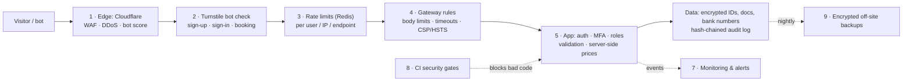

# 04 · Defence system: DROP

Defence in depth: a request has to get past every layer below, and each layer assumes the one before it can fail.
**Built** = in the code and covered by tests. **Owner setup** = something only you can switch on (an account, a key or a dashboard setting).

## 1. Edge layer (Cloudflare): owner setup, free to $20/month
The code is ready for it: CSP, `TRUST_PROXY=2` and the Turnstile hooks. To switch it on:
1. Add your domain to Cloudflare (Free plan) and point DNS at Railway as a **proxied** (orange-cloud) CNAME. Set SSL to **Full (strict)**.
2. **Security → Bots:** turn on Bot Fight Mode. On Pro ($20/month), use Super Bot Fight Mode and set definitely-automated traffic to "Block".
3. **WAF → Managed rules:** Cloudflare Managed Ruleset (Free tier includes the core free rules; OWASP Core Ruleset needs Pro).
4. **WAF → Rate limiting rules:** limit `/api/auth/*` to 20 requests per minute per IP and `/api/*` to 300 per minute per IP. This blocks floods before they reach Railway.
5. **Security → Settings:** turn on "Under Attack Mode" only during an incident (see the incident-response plan).
6. Then set `TRUST_PROXY=2` on Railway, so the app sees the visitor's real IP for its own limits and logs.

## 2. Bot defence (built; owner setup for keys)
- **Cloudflare Turnstile** checks sign-up, sign-in, driver applications, enquiries and booking (`edge.js → botCheck`). The widget is invisible and shows a checkbox only when Cloudflare is unsure. The website fetches the site key from `/api/security/config`, so no rebuild is needed.
- If Cloudflare is unreachable, the check fails open rather than locking every customer out. Failed checks are logged as security events.
- **Setup:** Cloudflare dashboard → Turnstile → Add widget (your domain, "Managed"), then set `TURNSTILE_SITE_KEY` and `TURNSTILE_SECRET_KEY`. This is free.
- **Behind the bot check:** identity verification before booking or driving, a duplicate-ID check, per-account lockout, and the breached-password check.
- **Native apps (Phase 5)** use Play Integrity and App Attest instead of Turnstile.

## 3. Rate limiting (built)
| Scope | Limit | Key |
|---|---|---|
| All API (`RATE_LIMIT_API`) | 600 / 15 min | signed-in user, else IP |
| Sign-in and sign-up | 25 / 15 min | IP |
| Same account, wrong password | lock after 5: 15 min, doubling up to 4 h | account (unknown emails too) |
| Two-step codes | 30 / 15 min per IP; lock after 5 wrong codes | IP, then account |
| Token refresh | 120 / 15 min | IP |
| Forms (driver application, enquiries) | 15 / 15 min | IP |
| Document uploads | 60 / 15 min | user |
| New bookings (`RATE_LIMIT_BOOKINGS`) | 20 / hour | user |
| Live GPS and call signalling | 1,500 / 15 min (outside the general limit) | user |
| Chat messages | 20 / minute | user |

All limits return `429` with `Retry-After` and standard `RateLimit` headers. With `REDIS_URL` set, the counts and lockouts are shared by every instance and survive deploys. Without it, they live in memory, which is fine for one instance.
**Owner setup:** in the DROP Railway project, add a Redis service (about $5–10/month) and reference its URL as `REDIS_URL`.

## 4. Gateway rules (built)
- 100 KB JSON body limit, 8 MB per upload (one file), 64 KB for the Paymentology XML endpoint.
- Server timeouts: request headers 20 s and request body 60 s (blocks slowloris-style attacks), keep-alive 65 s.
- Helmet headers:
  - HSTS for one year.
  - CSP with no inline scripts; only Google Maps and Cloudflare Turnstile hosts are allowed.
  - `frame-ancestors 'self'`, nosniff and Referrer-Policy.
  - Permissions-Policy limits the camera, microphone and location to DROP itself.
- CORS uses an allow-list. Payment-provider callbacks are verified by signature before anything else happens.

## 5. Application layer (built)
- **Sessions:**
  - A 15-minute access token kept in memory only.
  - A refresh token in an `HttpOnly; Secure; SameSite=Strict` cookie scoped to `/api/auth`, rotated on every use.
  - **Reuse detection:** if a stolen refresh token is used again, the whole session family is revoked and an alert raised.
  - A custom header blocks CSRF on refresh and logout.
- **Revocation:** password change, "sign out everywhere", suspension, role change, admin "sign out" and the platform-wide `SESSION_EPOCH`.
- **MFA:** mandatory authenticator-app codes for staff, optional for customers. Recovery codes, replay protection, encrypted secrets.
- **Authorization:** role checks on the server for every route, and ownership checks on every booking, document, message, call and tracking request. Demo accounts are isolated from real data (SEC-001).
- **Data protection:** ID numbers, KYC documents, bank numbers and MFA secrets are encrypted with AES-256-GCM. API responses strip secret fields. Fares, fees and refunds are always computed on the server.
- **Errors:** customers see generic messages; details go to the logs with a request ID.

## 6. Mobile app protection
Planned for Phase 5:
- **Session handling:** sign-in, refresh and logout for apps already work (`X-DROP-Client: mobile` returns the refresh token in the body, to be kept in the device keychain).
- **Device trust:** certificate pinning, Play Integrity and App Attest checked on the server for sign-in, booking and payment.
- **Release builds:** root/jailbreak signals, obfuscation, and a force-update gate.

## 7. Monitoring and detection (built; owner setup for alert destinations)
- **Structured JSON logs:** one line per API request with request ID, route pattern (never IDs or query strings), status, duration, hashed IP and short user ID. No bodies, tokens or personal data.
- **Security events** are stored (latest 5,000) and shown to admins in **Dashboard → Security**:
  - account lockouts, staff sign-ins (high severity for an admin from a new network)
  - refresh-token reuse, failed bot checks, maintenance on or off
  - backup results, audit-chain breaks
  - spikes (5-minute windows): failed sign-ins ≥ 50, server errors ≥ 20, rate-limited ≥ 200, failed two-step codes ≥ 20
- **Alerts:** high-severity events go to `ALERT_WEBHOOK_URL`. Create a Slack or Teams incoming webhook and paste it there.
- **Audit log:** append-only and SHA-256 hash-chained. Covers every KYC decision, chat read by staff, finance action, bank-account change, MFA change and maintenance switch. It is verified daily and shown as "intact" or "TAMPERED" on the Security tab.
- **Error tracking:** set `SENTRY_DSN` and add `@sentry/node` (free tier). Personal data is never sent.
- **Uptime:** owner setup. Add a free monitor (Better Stack, UptimeRobot) on `https://<your-domain>/api/health` every minute, alerting by SMS or email.

## 8. CI/CD security gates (built; owner setup to enforce)
`.github/workflows/ci.yml` runs on every push and pull request:

| Job | Tool | Fails on |
|---|---|---|
| Tests and build | node --test (17 suites), tsc and vite build | any failing test or type error |
| Dependencies | `npm audit --audit-level=high` and OSV-Scanner | known high or critical vulnerabilities |
| Secrets | gitleaks (full history) | any committed secret |
| Static analysis | Semgrep (OWASP Top 10, Node, Express, React, secrets, plus DROP's own rules) | ERROR-level findings |
| CodeQL | GitHub `security-extended` | alerts shown in the Security tab |

There is also `dast.yml` (an OWASP ZAP baseline against **staging**, run weekly and on demand) and Dependabot (weekly grouped updates).
**Owner setup:**
1. GitHub → Settings → Branches → protect `main`: require these checks and one review.
2. Turn on 2FA for every GitHub account with access.
3. Set the Actions variable `STAGING_URL` once staging exists.

## 9. Backups and recovery (built; owner setup for keys and storage)
- **Daily encrypted backup** of the whole data folder (database and KYC documents), using AES-256-GCM under `BACKUP_KEY`, which is separate from the file key. The last 14 copies are kept on the volume, and each backup is also uploaded to S3-compatible storage when `BACKUP_S3_*` is set.
- **Tested:** the test suite proves the backup is encrypted, that tampering is detected, that the off-site upload is correctly signed, and that a restore into an empty folder brings back every user, verification and document.
- **Restore:**
  1. Run `BACKUP_KEY=… npm run restore -- <file> <empty-folder>`.
  2. Start a service with `DATA_DIR=<folder>` and the same `FILE_ENCRYPTION_KEY`.
- **RPO/RTO today:** up to 24 h of data loss (daily backups); about 30 minutes to restore. **Phase 6** (managed Postgres with point-in-time recovery) brings this to under 5 minutes of data loss and under 15 minutes to restore.
- **Owner setup:**
  1. Generate `BACKUP_KEY` (for example `openssl rand -base64 48`), store it in a password manager **and** in Railway.
  2. Create a Railway Bucket (or Cloudflare R2) and set `BACKUP_S3_ENDPOINT`, `BACKUP_S3_BUCKET`, `BACKUP_S3_ACCESS_KEY` and `BACKUP_S3_SECRET_KEY`.
  3. Turn on Railway volume backups as an extra copy.

## 10. Incident response
See [incident-response.md](incident-response.md). It includes maintenance mode, platform-wide sign-out, key rotation and POPIA notification.

## Owner setup checklist (in priority order)
| # | Action | Cost |
|---|---|---|
| 1 | `DEMO_MODE=false`, `JWT_SECRET`, `FILE_ENCRYPTION_KEY` and `BACKUP_KEY` set on Railway | free |
| 2 | Bucket plus `BACKUP_S3_*` (off-site backups) | Railway Buckets or R2: cents a month at this size |
| 3 | GitHub: 2FA for everyone, branch protection with required checks | free |
| 4 | Cloudflare in front of the domain, Turnstile keys, then `TRUST_PROXY=2` | free (Pro $20/month optional) |
| 5 | Redis service, then `REDIS_URL` | about $5–10/month |
| 6 | Slack/Teams webhook in `ALERT_WEBHOOK_URL`; uptime monitor on `/api/health` | free |
| 7 | Sentry project, then `SENTRY_DSN` | free tier |
| 8 | Staging service on Railway (needed for ZAP and load tests) | about $5/month |
